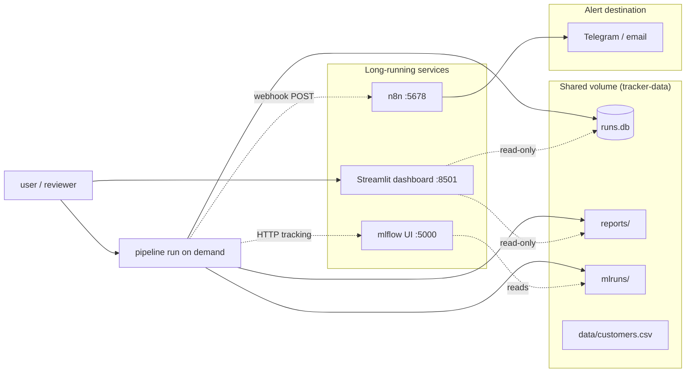

# AI Run Tracker & Monitor

Mini platform that runs a scikit-learn churn-prediction model (Random Forest),
tracks every run, checks data quality, monitors failures and slowness, sends
alerts via n8n, and produces a weekly report. Built for an internship-style
portfolio on "Workflow Automation, Data Management and Monitoring Tools".

## Architecture



A reviewer runs the pipeline on demand (data-quality check → train → SQLite →
alert). The dashboard and MLflow UI read the shared volume read-only, and n8n
forwards alerts to Telegram/email.

## Status

All 10 phases complete:

| Phase | Delivered |
|-------|-----------|
| 1 | Repo structure, synthetic data generator (~500 customers, deliberate defects), README skeleton |
| 2 | Data quality module (pandas) producing JSON + markdown reports; blocker / warning rules |
| 3 | MLflow-tracked training script (params, metrics, artifacts, tags; config-driven hyperparameters) |
| 4 | SQLite `runs` table: every run writes status, duration, error; `run_pipeline.py` orchestrator |
| 5 | pytest: v1 vs v2 regression test on the same data, fails if F1/recall drops >10% |
| 6 | Streamlit dashboard: runs per day, failures, slow runs, latest quality report |
| 7 | Alert logic + n8n webhook call; alerts never crash or change a run's status |
| 8 | Weekly report script (markdown): last 7 days vs previous 7 days, trends + recurring issues |
| 9 | Dockerfile + docker-compose.yml + demo.sh (one-command-ish stack) |
| 10 | Final README (this file) with architecture diagram, how to run, screenshots, lessons, limitations |

## Design decisions (recorded)

- **Blocker rule:** missing or duplicate `customer_id` blocks a run on any single failure.
  `payment_amount < 0` and `last_login_days_ago < 0` block only if >5% of rows are affected;
  otherwise the bad rows are removed and listed in the report. `attendance_rate` outside [0,1]
  is always a warning, rows removed.
- **Slow run:** duration > 2x the median of the last 20 successful runs; fixed fallback of 10s
  until 20 successes exist.
- **Repeated failure:** 3 failures in the last 10 runs; alerted only when the threshold is
  crossed (not on every failing run after that).
- **Alerts:** POST JSON to the n8n webhook (`N8N_WEBHOOK_URL`, default
  `http://localhost:5678/webhook/pipeline-alert`). Alert failures are logged as warnings and
  never crash or change a run's status. 5-second HTTP timeout.

## Repo structure

| Path | Purpose |
|------|-----------|
| `ai_run_tracker/data/generate.py` | Synthetic customer dataset generator (Phase 1) |
| `ai_run_tracker/quality/` | Data quality rules + JSON/markdown report (Phase 2) |
| `ai_run_tracker/training/train.py` | MLflow-tracked training script (Phase 3) |
| `ai_run_tracker/runs_db.py` | SQLite runs + alerts store (Phases 4/7) |
| `ai_run_tracker/run_pipeline.py` | Pipeline orchestrator: quality → train → SQLite → alerts (Phases 4/7) |
| `ai_run_tracker/alerts/alerter.py` | n8n webhook alert logic (Phase 7) |
| `ai_run_tracker/dashboard/app.py` | Streamlit dashboard (Phase 6) |
| `ai_run_tracker/reports/weekly_report.py` | Weekly report script (Phase 8) |
| `tests/test_regression.py` | pytest v1 vs v2 regression test (Phase 5) |
| `reports/` | Quality + weekly report output |
| `mlruns/` | MLflow local tracking store |
| `Dockerfile`, `docker-compose.yml` | One-command Docker Compose stack (Phase 9) |
| `demo.sh` | One-command demo script (Phase 9) |
| `.env.example` | n8n webhook URL template (no secrets) |
| `NOTES.md` | Real bugs and surprises from the build |

## How to run

### Local (no Docker)

```bash
cd ai-run-tracker
python3 -m venv .venv
source .venv/bin/activate
pip install -r requirements.txt

# 1. Generate the synthetic dataset
python3 -m ai_run_tracker.data.generate

# 2. Run the full pipeline (quality check, train, SQLite record, alert)
python3 -m ai_run_tracker.run_pipeline --model-version v1

# 3. View the dashboard
python3 -m streamlit run ai_run_tracker/dashboard/app.py

# 4. Generate the weekly report
python3 -m ai_run_tracker.reports.weekly_report --db runs.db

# 5. Run the regression test (v1 vs v2)
python3 -m pytest tests/ -v
```

Exit codes from the pipeline: `0` = SUCCESS, `2` = BLOCKED by data quality,
`1` = FAILED/crashed. Every run still writes a SQLite row and is logged to MLflow.

### Docker Compose

```bash
# Long-running services
docker compose up -d mlflow dashboard n8n

# One-shot pipeline runs (on demand; the pipeline service does NOT auto-start)
docker compose run --rm pipeline --model-version v1 --data /app/data/customers.csv

# Full end-to-end demo (generates data, runs v1/v2/failure, weekly report)
./demo.sh
```

Open: MLflow `http://localhost:5000`, Dashboard `http://localhost:8501`, n8n `http://localhost:5678`.

Inside Compose, MLflow is at `http://mlflow:5000` and the n8n webhook at
`http://n8n:5678/webhook/pipeline-alert`. Override the webhook URL via
`N8N_WEBHOOK_URL` (see `.env.example`).

## Screenshots

Add screenshots here of:

1. **Streamlit dashboard** — runs-per-day bar chart, failure/slow-run counts, latest data-quality report, recent runs table (`http://localhost:8501`).
2. **MLflow UI** — experiment `churn-run-tracker` with v1/v2 runs, params, metrics, artifacts (`http://localhost:5000`).
3. **n8n** — imported workflow receiving the webhook POST and forwarding to Telegram/email (`http://localhost:5678`).
4. **Weekly report** — generated `reports/weekly/weekly_YYYY-MM-DD.md` markdown.

Capture these after running `./demo.sh` so the dashboard and reports are populated.

## What I learned

- `random.Random.random()` takes no arguments — generate defect masks with a list comprehension.
- No `pip` and PEP 668 externally-managed environment — bootstrap pip with `get-pip.py --break-system-packages`.
- pandas `DataFrame.sample(random_state=)` rejects `random.Random`; seed with an int instead.
- `datetime.utcnow()` is deprecated in Python 3.12 — use `datetime.now(timezone.utc)`.
- A blocked run must still be logged (MLflow `status=FAILED`, SQLite row), not silently skipped.
- Alert failures must never crash the pipeline — wrap webhook calls in try/except and continue.
- MLflow logs a warning when a model is saved without a signature or input example.
- Docker shared volumes need careful read-only mounts (dashboard reads, pipeline writes).

## Known limitations

- Synthetic dataset only (~500 customers) with a small Random Forest — not production-scale data.
- SQLite is a single-writer store; concurrent writers from multiple containers can contend.
- Local demo only — no authentication, HTTPS, or secrets management.
- Simple threshold rules (2x median duration, 3-in-10 failures) rather than anomaly detection.
- MLflow file-store backend (not a managed service such as Databricks).
- Reports are markdown only; no PDF generation (no extra dependency added).
- n8n webhook URL defaults to localhost; alerting requires a running n8n instance.
- Deliberate dataset defects mean the default `data/customers.csv` produces BLOCKED runs.
